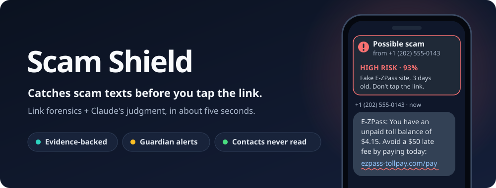
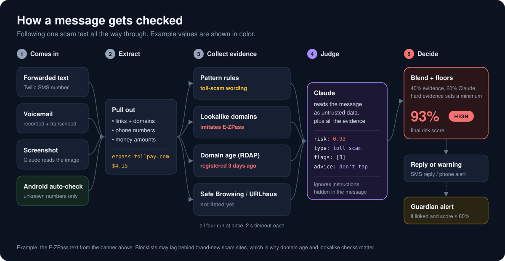
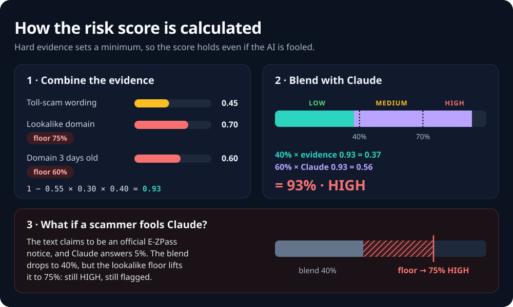
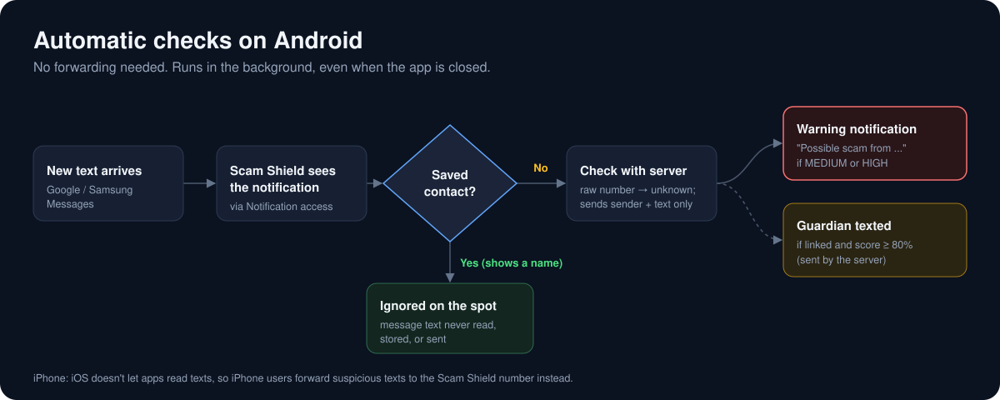

# Scam Shield

<picture>
  <source media="(max-width: 700px)" srcset="docs/hero-mobile.svg">
  
</picture>

Forward a suspicious text, voicemail or screenshot, or let the Android app check texts from unknown
numbers automatically, and get an evidence-backed scam verdict in seconds. Linked "guardians" (e.g. an
adult child) get alerted when a protected relative receives a likely scam.

## How it works

<picture>
  <source media="(max-width: 700px)" srcset="docs/pipeline-mobile.svg">
  
</picture>

<picture>
  <source media="(max-width: 700px)" srcset="docs/scoring-mobile.svg">
  
</picture>

- **Collectors** (`app/collectors/`) produce `Signal`s with a weight; hard evidence (blocklist hit, lookalike
  brand domain, domain < 30 days old) also sets a *floor* the final score can't drop below.
- **Claude** (`app/llm.py`) gets the message as untrusted data plus the evidence, and returns a structured
  `LLMVerdict` (score, scam type, red flags, advice). Server-side refusal fallback is enabled.
- **Blend** (`app/pipeline.py`): 40% noisy-OR of signals + 60% Claude, then apply floors. If Claude is
  unavailable the service still answers using rules only.

## Run it

```bash
python -m venv .venv && .venv/Scripts/pip install -r requirements.txt   # (bin/ on macOS/Linux)
cp .env.example .env        # add ANTHROPIC_API_KEY (or run `ant auth login`)
.venv/Scripts/uvicorn app.main:app --reload
# open http://localhost:8000
.venv/Scripts/python -m pytest       # offline tests
```

## Endpoints

| Route | Used by |
|---|---|
| `POST /api/check` (form: `text`, optional `image`) | Web page |
| `POST /api/device/check` (JSON: `sender`, `body`, `owner`) | Phone app, automatic checks |
| `POST /twilio/sms` | Twilio "A message comes in" webhook |
| `POST /twilio/voice` → `/twilio/transcription` | Twilio voice webhook (record + transcribe) |

## Twilio setup

1. Expose the app: `ngrok http 8000`, put the URL in `PUBLIC_BASE_URL`.
2. In the Twilio console, set the number's messaging webhook to `<url>/twilio/sms` and voice webhook to
   `<url>/twilio/voice`.
3. Add `GUARDIANS=+1protected:+1guardian` to try guardian alerts.

## Android app (automatic checks): `mobile/`

<picture>
  <source media="(max-width: 700px)" srcset="docs/android-mobile.svg">
  
</picture>

Expo app with a local native module (`mobile/modules/sms-guard`) that runs a
`NotificationListenerService`. When a texting app (Google Messages, Samsung Messages, ...) shows a
notification from a sender that isn't a saved contact, it POSTs the text to `/api/device/check` and,
if the risk is MEDIUM/HIGH, posts a "Possible scam from ..." warning notification. Guardian alerts fire
server-side. Works even when the app is closed.

It needs native code, so Expo Go won't work. Use a development build:

```bash
cd mobile
npx eas-cli@latest build --platform android --profile development   # cloud build, installs as APK
# or, with Android Studio installed: npx expo run:android
npx expo start          # then open the dev build on the phone
```

On the phone: set the Server URL (your ngrok https URL), tap **Turn on protection**, allow
Notification access for Scam Shield, then tap **Try a sample scam** or text the phone from a number
that isn't in its contacts.

iOS can't read texts, so iPhone users use the forward-to-number flow.

## TODO

- Persist reports in Postgres + pgvector; similarity search against known scams
- Phone-number intelligence (VoIP / carrier lookup)
- Device auth + rate limiting on `/api/device/check`
- Evaluate on `data/demo_messages.jsonl` + a larger labeled set; report accuracy / false-positive rate

## Diagrams

The images above are built from `docs/src/*.svg`. Edit those, then run `python docs/build_svgs.py`
to embed the [Geist](https://github.com/vercel/geist-font) font (SIL OFL, `docs/fonts/`) so they render
the same on every OS. Phone-width versions (`*-mobile.svg`) are swapped in by `<picture>` on narrow screens.
